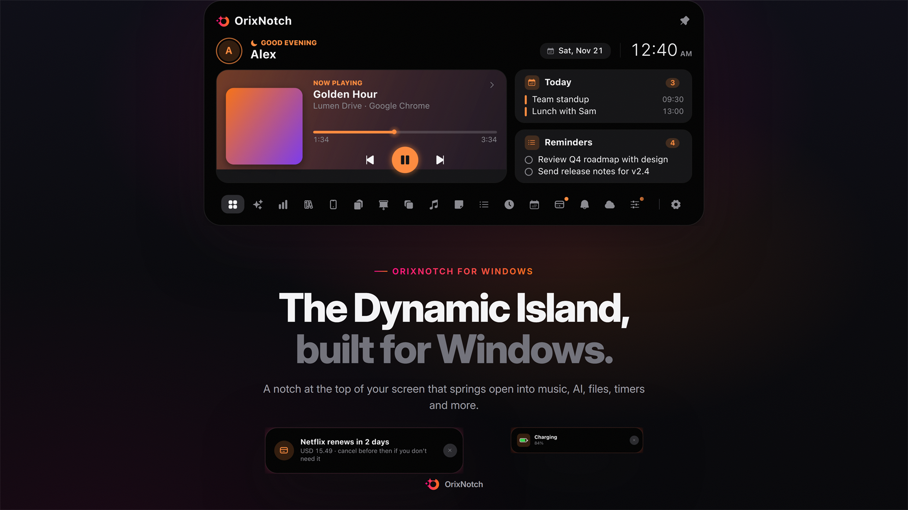
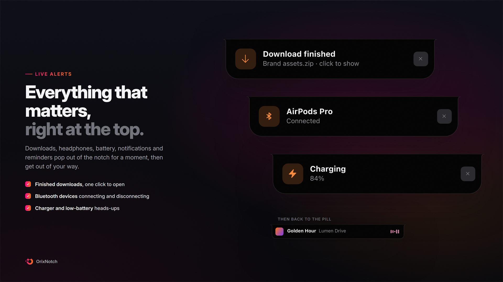
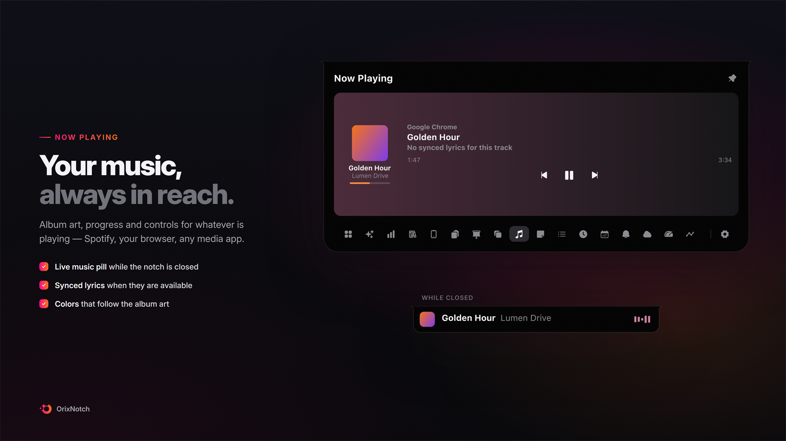
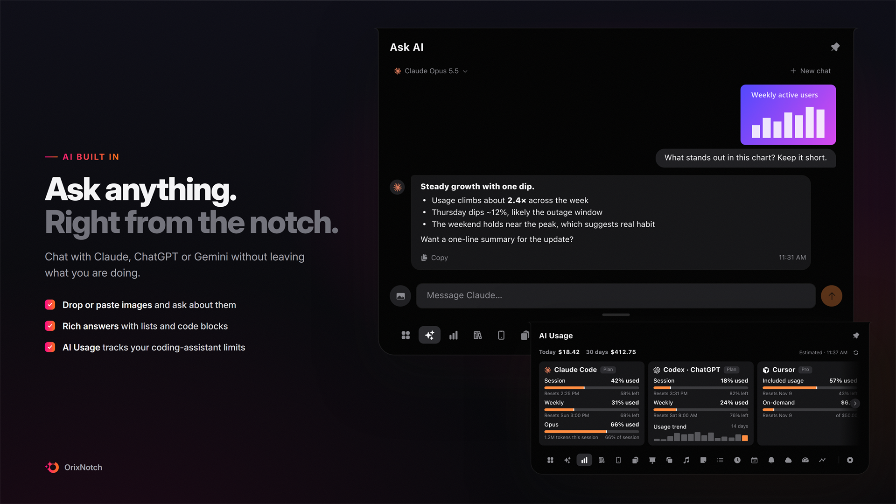
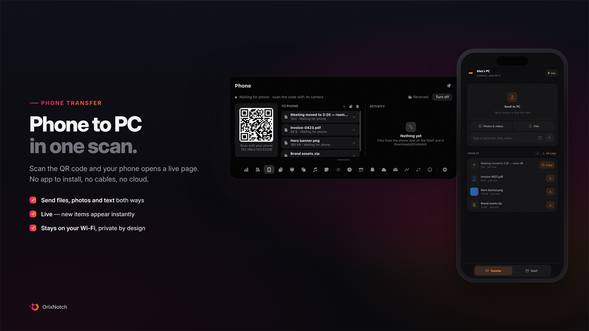
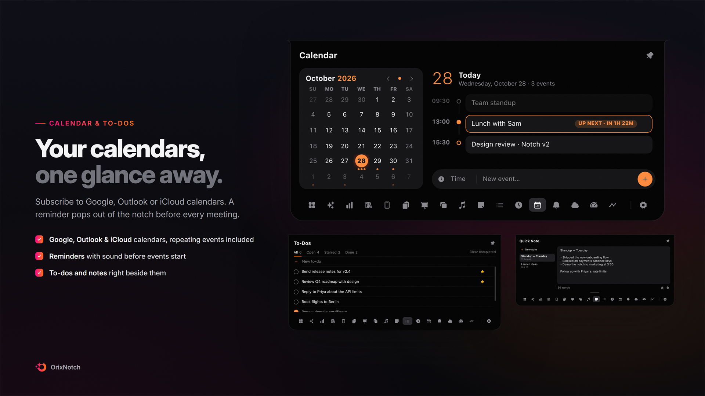
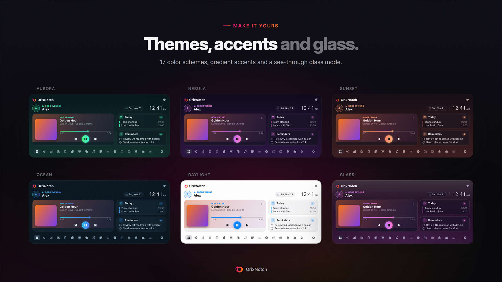

<div align="center">


# OrixNotch

**Your screen, smarter.** A dynamic island for Windows.

A small notch sits at the top of your screen and springs open into music, AI, files, timers and more,<br/>
then gets out of your way.

[](https://github.com/faisal-shohag/orixNotch/releases/latest)
[](https://github.com/faisal-shohag/orixNotch/actions/workflows/ci.yml)
[](#install)
[](https://dotnet.microsoft.com/)

<a href="https://apps.microsoft.com/detail/9PM8RN7CGSWC"></a>

[**Download**](https://github.com/faisal-shohag/orixNotch/releases/latest) · [Website](https://orixnotch.vercel.app/) · [Privacy](docs/privacy-policy.md) · [Build from source](#build-from-source)

<br/>



</div>

---

## Why OrixNotch

- **Always there, never in the way.** Hover the notch, click it, or press <kbd>Ctrl</kbd>+<kbd>Alt</kbd>+<kbd>N</kbd>. It steps aside for full-screen videos, games and apps you pick.
- **Useful while closed.** Live music, timers, reminders and an idle view you choose (clock, weather, battery, network speed, AI limits and more), right in the pill.
- **Alerts that don't interrupt.** Reminders, Windows notifications, downloads, Bluetooth and battery events pop out of the notch for a moment, then go away.
- **Private by design.** No account, no analytics, no ads. Your data stays on your PC.

## Screenshots

<table>
  <tr>
    <td width="50%"><p align="center"><sub><b>Alerts</b> out of the closed notch</sub></p></td>
    <td width="50%"><p align="center"><sub><b>Now Playing</b> with synced lyrics</sub></p></td>
  </tr>
  <tr>
    <td><p align="center"><sub><b>Ask AI</b> with Claude, ChatGPT, Gemini or DeepSeek</sub></p></td>
    <td><p align="center"><sub><b>Phone transfer</b> by QR code, no app needed</sub></p></td>
  </tr>
  <tr>
    <td><p align="center"><sub><b>Calendar</b> with Google, Outlook and iCloud sync</sub></p></td>
    <td><p align="center"><sub><b>Themes</b> and accents, applied live</sub></p></td>
  </tr>
</table>

## Tools

Turn tools on or off and reorder them in **Settings → Tabs**. The first launch opens there so you can pick yours.

**Everyday**

| Tool | What it does |
| --- | --- |
| **Home** | A glance at your day: greeting, music, today's events and reminders. |
| **Now Playing** | Art, controls, seek bar and synced lyrics for any app using Windows media controls (Spotify, browsers, Media Player…). |
| **Calendar** | Month view with your own events and reminders, plus read-only subscribed calendars from a Google, Outlook or iCloud `.ics` link, repeating events included. |
| **To-Dos** | A quick list with stars and completion. |
| **Quick Note** | An auto-saving scratchpad. |
| **Timers** | Pomodoro, countdown and stopwatch, with the countdown visible in the closed notch. |
| **Weather** | Current conditions, humidity, wind, daylight and a 7-day forecast from Open-Meteo. No API key. |

**Files and text**

| Tool | What it does |
| --- | --- |
| **Shelf** | Drop files or text on the notch to park them, then drag them back out, open, reveal or copy. |
| **Phone** | Send files, folders and text both ways with any phone on the same Wi-Fi: scan the QR code and a page opens. No app to install. Off until you turn it on. |
| **Clipboard** | Searchable history of text, links, images and files. Skips clips that password managers mark as private. |
| **Teleprompter** | Scrolling script for calls and recordings, with one-tap hide from screen sharing. |

**AI**

| Tool | What it does |
| --- | --- |
| **Ask AI** | Chat with **Claude, ChatGPT, Gemini or DeepSeek** using your own API key. Drop or paste images to ask about them, or explain selected text from any app. |
| **AI Usage** | Limits and usage for Claude Code, Codex, Cursor, OpenCode, Antigravity and more, with an alert before you run out. |

**Your PC**

| Tool | What it does |
| --- | --- |
| **Notifications** | Your Windows notifications, mirrored on the notch, with an unread count. |
| **Controls** | Quick toggles and per-app volume, Control Center style. |
| **System** | CPU, memory, disk, network and battery with live charts, and the apps using the most. |
| **Screen Time** | Time per app, daily goals and an end-of-day summary. |
| **Shortcuts** | One-click tiles for apps, folders, links and Windows settings pages. |

**Extras**

| Tool | What it does |
| --- | --- |
| **Subscriptions** | Track renewals and get alerted before you're charged. |
| **Stocks** | A watchlist with intraday sparklines. |
| **Converter** | Units and live currency rates. |
| **Emoji** | Full emoji picker with search and recents. Click to copy. |

## Make it yours

- **Shape and position.** Island, Notch, Tab or Pill, on any screen edge. It can follow your pointer to another display.
- **Visibility.** Always shown, shown only while something is happening, or hidden until the pointer touches the edge. It fades for full-screen apps and apps you choose, and can be left out of screenshots and screen sharing.
- **Look.** 19 color schemes and 24 accents (some gradients), glass tinted by your wallpaper, and one-click looks. Changes apply live.
- **Closed notch.** Pick what it shows while idle (clock, weather, battery, network, AI limits, unread notifications…), one at a time or all in a row.
- **Focus and calm.** Focus sessions that hold alerts, quiet hours, break reminders and a morning brief.

## Keyboard and automation

| Action | How |
| --- | --- |
| Open or close the notch | <kbd>Ctrl</kbd>+<kbd>Alt</kbd>+<kbd>N</kbd> |
| Command palette | Type `timer 10`, `todo buy milk`, `20 usd to eur`, `ask …` or a tool's name |
| Ask AI, clipboard, teleprompter, focus, explain selection, copy text from screen, mute mic, keep awake | Assign your own shortcuts in **Settings → Keyboard** |
| From scripts and CI | `orixnotch://peek?text=Build%20done` shows an alert; `orixnotch://open/weather` opens a tool |

## Install

Get it from the [**Microsoft Store**](https://apps.microsoft.com/detail/9PM8RN7CGSWC), or download the latest build from [**Releases**](https://github.com/faisal-shohag/orixNotch/releases/latest). Requires Windows 10 version 2004 or later, or Windows 11.

| Package | Best for | Updates |
| --- | --- | --- |
| [Microsoft Store](https://apps.microsoft.com/detail/9PM8RN7CGSWC) | The easiest install. | Automatic, through the Store |
| `OrixNotch-x.y.z-setup.msi` | Most people. Per-user install, no admin rights needed. | Downloads in the background, installs when you click |
| `OrixNotch-x.y.z-portable.exe` | Trying it out, or running from a USB drive. | Tells you when a new version is out |

Every release includes `SHA256SUMS.txt`, so you can verify what you downloaded.

## Privacy

Everything is stored locally in `%LOCALAPPDATA%\OrixNotch`. API keys and calendar links are encrypted with Windows DPAPI.

The network is used only for features you turn on: Open-Meteo (weather), Yahoo Finance (stocks), LRCLIB (lyrics), ExchangeRate-API (currency rates), the AI provider you choose, calendars you subscribe to, and GitHub or the Microsoft Store for updates. Phone transfer stays on your local network and never goes through a server.

Full details are in the [privacy policy](docs/privacy-policy.md).

## Build from source

Requires the [.NET 8 SDK](https://dotnet.microsoft.com/download/dotnet/8.0) on Windows.

```powershell
git clone https://github.com/faisal-shohag/orixNotch.git
cd orixNotch
dotnet run --project src/OrixNotch

# start with the panel open on a tool, or on Settings
dotnet run --project src/OrixNotch -- --open weather
dotnet run --project src/OrixNotch -- --settings
```

> [!TIP]
> OrixNotch runs as a single instance. Close any running copy before building, and set `ORIXNOTCH_DATA_DIR` to a scratch folder to test without touching your own data.

Installers are built by the scripts in [`packaging/`](packaging) (`Build-Exe.ps1`, `Build-Msi.ps1`, `Build-Msix.ps1`). CI builds all three on every pull request. The release process, code signing and Microsoft Store setup are in [docs/RELEASING.md](docs/RELEASING.md).

<details>
<summary><b>Project layout</b></summary>

```
src/OrixNotch/
  Shell/       Notch window, spring animation, tab bar, shared controls and icons
  Tools/       One UserControl per tool
  Services/    Media, clipboard, phone transfer, AI, calendar, settings, storage, updates…
  Settings/    Settings window
  Themes/      Theme brushes and control styles
  Interop/     Win32 P/Invoke
packaging/     Portable exe, MSI (WiX) and MSIX builds
docs/          Design notes, releasing, privacy policy
```

</details>

## Credits

- Icons: [Heroicons](https://heroicons.com/), [Tabler Icons](https://tabler.io/icons) and [Phosphor](https://phosphoricons.com/), all MIT.
- Typeface: [Inter](https://rsms.me/inter/), SIL Open Font License.
- Data: [Open-Meteo](https://open-meteo.com/) for weather and [LRCLIB](https://lrclib.net/) for lyrics.

<div align="center">
<br/>
<sub>Made for Windows by <a href="https://github.com/faisal-shohag">Abu Nayim Faisal</a></sub>
</div>
